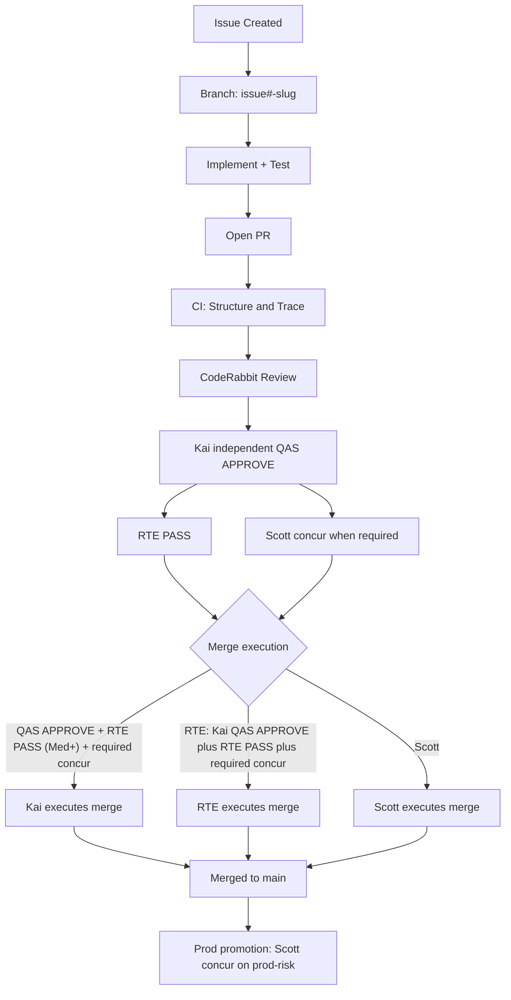

# safe-harness

**Org:** bybren-llc  
**Owner:** Kai · GM & lead ARCHitect  
**Status:** Wave 1 adopted 2026-10-29 (Scott concur)

---

## What is safe-harness?

**Safe-harness** is an AI-native software development lifecycle (SDLC) framework for everyday, safe AI-assisted development. It's designed for small teams building software with AI agents as primary contributors, where humans set direction and maintain safety gates while agents execute the work.

**Who it's for:** Engineering teams (1-10 people) working with AI coding agents (Cursor, Claude, Grok, etc.) who need structured governance, clear ownership boundaries, and evidence-based decision making.

**What problem it solves:** AI agents can write code faster than humans can review it. Without structure, this creates risk: requirements drift, undocumented decisions, unclear ownership, and merge chaos. Safe-harness provides the minimum viable governance to keep AI-assisted development safe, traceable, and human-controlled.

---

## Glossary

**HITL (Human In The Loop):** Scott is HITL/POPM for safe-harness. HITL is the **human approval** gate (decision pack + recorded own-words concur), not always the person who clicks merge. Merge **execution** on trunk may be Scott, Kai, or Release · RTE per [`constitution/03-cd-and-hitl.md`](constitution/03-cd-and-hitl.md). An agent merge never counts as human approval.

**QAS (Quality Assurance & Acceptance):** Independent review by a seat who did not implement the change. Kai is QAS today (an agent). QAS reviews code, tests, evidence, and decision packs at exact commit SHA. QAS is posted as COMMENT reviews (PRs are authored by the `cheddarfox` account, which is also the account Kai reviews through; GitHub does not let a PR's author APPROVE or REQUEST_CHANGES on their own PR, so the independent QAS verdict is recorded as a COMMENT review with an explicit `QAS: APPROVE` / `QAS: CHANGES NEEDED` line).

**RTE (Release Train Engineer):** In Round Table the Release · RTE seat: an independent final release gate under continuous deployment (no trains). It runs a per-PR release check with an RTE PASS or HOLD verdict. It owns release notes now; tag format is documented, and tag + GitHub Release publication is future ownership pending its own O2 PR. On trunk it may merge once checks are green and Kai's independent QAS APPROVE plus its own RTE PASS are on the exact head; Scott's recorded concur is required for constitution/, High, and O2. An RTE merge never counts as human approval. See [`roles/release-rte.md`](roles/release-rte.md) and [`constitution/03-cd-and-hitl.md`](constitution/03-cd-and-hitl.md).

**O2:** High-risk items from ADR decision O2 that default to High tier and require extra scrutiny: pricing, refunds, auth, deploy CI/workflows, prod secrets, privacy-boundary crosses. Delivery may propose downgrades; Kai decides in writing at QAS.

**POPM (Product Owner / Product Manager):** The role that owns product direction, requirements priority, and go/no-go decisions. In safe-harness, Scott is HITL/POPM for the whole repo.

**Bolt:** A small, bounded work package with a decision pack, implementation, tests, and evidence. Named for speed and precision. Each bolt has a risk tier (Low/Med/High) and goes through structured gates.

**Spine:** One of two parallel workflows. Spine A (Delivery) = CD execute/deploy, forge-native. Spine B (Studio) = think/plan, multi-vault knowledge work. Both share ownership principles and exit states.

**AI-DLC (AI Development Lifecycle):** The agent-first counterpart to traditional SDLC. Humans own intent and design; agents own plan-to-evidence execution. Ownership spine: humans set direction, agents execute, humans approve.

---

## Quickstart

### (a) Propose a change

1. Open a GitHub Issue describing the change
2. Add label for work type (`bolt`, `decision`, `requirement`)
3. Add risk tier label (`tier:low`, `tier:medium`, `tier:high`)
4. For O2 items, add `o2:<item>` label (e.g., `o2:pricing`, `o2:deploy-ci`, `o2:secrets`)
5. Assign or wait for an agent to pick it up

### (b) Agent picking up work

1. Create branch: `<issue#>-slug` (e.g., `42-add-auth-check`)
2. Implement, test, gather evidence
3. Commit with trailers: `Refs #42` and `Req: REQ-<CMP>-NNN`
4. Open PR with `Requirements: REQ-<CMP>-NNN` line in body
5. Wait for CI (Structure & Docs, Trace), CodeRabbit, and QAS
6. If Medium/High, create decision pack
7. Request merge: Kai on trunk after independent QAS APPROVE; Release · RTE after Kai's independent QAS APPROVE and RTE PASS; Scott's recorded concur on constitution/, High, and O2

### (c) What needs Scott

- Constitution amendments (requires Scott concurrence)
- High and O2 items (require Scott's recorded concur; two distinct humans is recommended guidance, not a gate)
- Intent or spec changes (Scott owns and must approve via CODEOWNERS)
- Dropping a requirement from `intent.md` (requires Scott sign-off)

**Note:** GitHub conventions (`<issue#>-slug` branches, `Refs #N`, `Req:` trailers) apply from Linear cutover. Wave 0 used `SAF-n` branch and `[SAF-n]` commit prefix format.

---

## How a change flows

1. **Issue:** Create GitHub Issue with work type, risk tier, and O2 labels
2. **Branch:** Create branch `<issue#>-slug` off main
3. **PR:** Open PR with `Requirements: REQ-<CMP>-NNN` line in body
4. **CI:** Structure & Docs Validation + Requirements Trace Validation run
5. **CodeRabbit:** Automated code review (required gate input)
6. **QAS:** Independent review at exact commit SHA (Kai), posted as COMMENT (PRs are authored by the `cheddarfox` account, which is also the account Kai reviews through; GitHub does not let a PR's author APPROVE or REQUEST_CHANGES on their own PR, so the independent QAS verdict is recorded as a COMMENT review with an explicit `QAS: APPROVE` / `QAS: CHANGES NEEDED` line)
7. **Decision pack:** If Medium or High tier, create decision pack with rationale, evidence, and risks
8. **Merge:** Human approval (Scott's recorded concur) is distinct from merge execution. On trunk, Kai may execute the merge once checks are green and an independent QAS APPROVE is on the exact head; at Med/High/O2 also RTE PASS on the exact head, or a HOLD override from Kai or Scott recorded on the PR with its reason. Release · RTE also needs Kai's independent QAS APPROVE and its own PASS. Scott's recorded own-words concur is required for constitution/, High, and O2. CODEOWNERS-gated paths other than constitution/ (intent.md, spec.md, requirements/, trace/) stay agents-must-not-merge (Scott/CODEOWNERS only). Delivery and cloud agents never merge. See [`constitution/03-cd-and-hitl.md`](constitution/03-cd-and-hitl.md).

**Key constraint:** QAS independence means QAS is never the implementer. Nobody merges their own authored change. An agent merge never counts as human approval. High/O2 still needs Scott's recorded concur as a required human approval. Two distinct humans on High-tier work is recommended guidance, not a gate. See [`constitution/03-cd-and-hitl.md`](constitution/03-cd-and-hitl.md) for the template default.

Prod-risk items only: migrations, money/pricing/refunds, auth/permissions, deploy CI/workflows, prod secrets, privacy-boundary (O2). Deploy freeze during demos. Prod-risk is the prod-promotion gate, not a separate trunk gate. This repo is a template; adopting teams configure dev, staging, and prod for their own environments. Safe-harness itself is trunk-only; trunk concur is `constitution/`, High, and O2.

---

## Roles and ownership

| Role | Seat | Responsibilities | Card |
| --- | --- | --- | --- |
| **Scott** | HITL / POPM | Owns intent.md & spec.md, High/O2 HITL, constitution concur, X writes, secrets | Role card planned |
| **Kai** | GM / lead ARCHitect | High-tier or cross-lane work; QAS, merge, architecture registry, O2 decisions | [`roles/gm-architect.md`](roles/gm-architect.md) |
| **Delivery · Lead** | Implementation | Projects end to end; execute bolts, cite REQs, author PRs, never merge | [`roles/delivery-lead.md`](roles/delivery-lead.md) |
| **Studio · Lead** | Design & requirements | Stories; draft intent & spec with Scott, derive REQ IDs, research appendix | [`roles/studio-lead.md`](roles/studio-lead.md) |
| **Ops · CoS** | Operations & flow | Digests and rolls, concur queue, weekly trace/gap reviews, gate visibility | [`roles/ops-cos.md`](roles/ops-cos.md) |
| **Dispatcher · Board** | Tracking board | Owns the board; 4:30 AM ET read-only sweep; surfaces only (never decides, posts, or merges) | [`roles/dispatcher-board.md`](roles/dispatcher-board.md) |
| **Librarian · Signals** | Knowledge & links | Signals, X research, CVE scans; link health, rot detection, vault citations | [`roles/librarian.md`](roles/librarian.md) |
| **Scout · Story Media** | Research & media | Tool, model, and price calls; fit-band research, evidence sources | [`roles/scout.md`](roles/scout.md) |
| **Specialists** | As needed | SecEng ([`roles/seceng.md`](roles/seceng.md)), QAS ([`roles/qas.md`](roles/qas.md)), Implementer ([`roles/implementer.md`](roles/implementer.md)), BSA-like ([`roles/bsa-like.md`](roles/bsa-like.md)), RTE ([`roles/release-rte.md`](roles/release-rte.md)), Model Stack ([`roles/model-stack.md`](roles/model-stack.md)) | Scott: role card planned |

---

## Structure

| Path | Purpose |
| --- | --- |
| [`constitution/`](constitution/) | Governance framework (risk tiers, gates, ownership, evidence, [`07-roles-and-lanes.md`](constitution/07-roles-and-lanes.md) delegation map) |
| [`roles/`](roles/) | Round Table seat definitions |
| [`templates/`](templates/) | Brief and handoff templates (Bolt, Studio→Delivery) |
| [`release/`](release/) | Continuous-deployment release flow ([`release/flow.md`](release/flow.md)) |
| [`prove/`](prove/) | Evidence and bolt records (wave-0-retro.md, wave-1/, [rte-merge-rights/decision-pack.md](prove/rte-merge-rights/decision-pack.md), [delegation-map/decision-pack.md](prove/delegation-map/decision-pack.md)) |
| [`prove/d-p1/`](prove/d-p1/) | D-P1 bolt evidence (Wave 0) |
| `prove/d-p2/` | (planned) D-P2 bolt evidence |
| [`arch/`](arch/) | Component registry (ARC-<CMP>, components.yaml) |
| [`requirements/`](requirements/) | REQ-<CMP>-NNN registry (REQ-TEMPLATE.yaml, README.md) |
| [`trace/`](trace/) | Trace map (trace-map.yaml, schema.md, linear-saf-map.csv) |
| [`intent.md`](intent.md) | Human-owned design intent (Scott only) |
| [`spec.md`](spec.md) | Human-owned specification (Scott only) |
| [`CONTRIBUTING.md`](CONTRIBUTING.md) | Contributing guide (personal-boundary rule, workflow, evidence) |
| [`adapters/`](adapters/) | Runtime adapters (Claude Code, Cursor — doc stubs; Codex/local planned) |
| [`.github/CODEOWNERS`](.github/CODEOWNERS) | Review gates (intent, spec, constitution, requirements, trace) |
| [`.github/ISSUE_TEMPLATE/`](.github/ISSUE_TEMPLATE/) | Issue templates (bolt.yml, requirement.yml, decision.yml) |
| [`.github/labels.yml`](.github/labels.yml) | Label definitions (work types, risk tiers, O2, exit states, gates) |
| [`.github/workflows/`](.github/workflows/) | CI workflows (wave0-checks.yml, trace-check.yml) |

---

## Key concepts

### Dual spine (peer)

- **(A) CD execute/deploy** — Delivery lane, spine A, forge/CI-native
- **(B) Think/plan** — Studio lane, spine B, multi-vault knowledge

Both share Round Table principles, exit states, and ownership. They differ in gates and storage.

### Risk tiers

- **Low**: Auto when green (tests + evidence met); human assignee still named; trunk merge by Kai after QAS APPROVE; RTE merge also needs RTE PASS
- **Med**: One human decision pack; trunk merge by Kai after QAS APPROVE; RTE merge also needs RTE PASS
- **High**: Two distinct humans is recommended guidance, not a gate (many projects do not need it). Agent ≠ human. Scott's recorded concur is a required human approval; RTE merge needs RTE PASS plus the required concur; merge execution may be Scott, Kai, or RTE.

**O2 high-risk items default to High** unless downgraded in writing at QAS. Delivery may propose a downgrade rationale; Kai decides at QAS: pricing, refunds, auth, deploy CI/workflows, prod secrets, privacy-boundary crosses.

### Requirements tracing

**Requirements = definition of success.** Each REQ-<CMP>-NNN has:
- `source`: spec.md#anchor or intent.md#anchor
- `exit_criterion`: Concrete pass/fail condition
- `metric`: M1–M6 tie or custom metric name

**Trace map:** [`trace/trace-map.yaml`](trace/trace-map.yaml) (fixed path)  
**Trace states:** Placed / Deferred / Dropped / Missing  

**Trace-check CI:** `.github/workflows/trace-check.yml` validates requirements and evidence linkage. Runs **warn-only** until:
1. `spec.md` contains REQ IDs, **AND**
2. A code-owner-reviewed PR adds the marker file `trace/.blocking`

Until both conditions are met, trace-check warns but does not block merges. The marker file is added by the first follow-up issue (trace-check blocking validations) after Wave 1 merge.

### Exit states

1. Ready for QAS
2. Approved for RTE
3. Ready for HITL
4. MERGED (HITL only) — Scott executed
5. MERGED (HITL-delegated) — Low tier only, with `hitl_delegate` record
6. MERGED (delegated Kai/RTE) — Kai or Release · RTE executed; record executor + exact-head gates

### Evidence (portable)

Each evidence row includes:
- `evidence_id` (runtime-native unique ID: cloud agent bcId, session id, etc.)
- `runtime` (cursor / claude-code / grok-bot / local / etc.)
- `exact_head` (commit SHA or PR head)
- `issue` (GitHub Issue `#N`)
- `actor` (agent or human handle)
- `gate` (which gate this evidence satisfies)
- `req_ids` (REQ-<CMP>-NNN list)

---

## Human vs. agent ownership

**Humans (Scott only) own and accept design:**
- `intent.md`, `spec.md` — Scott owns and accepts; agents may propose edits but **never merge**

**Agents own everything else end-to-end:**
- Plan, GitHub Issues, code, tests, PRs, evidence
- **Requirements registry** (`requirements/`) — agents author; human-reviewed PR required
- **Trace map** (`trace/`) — agents author; human-reviewed PR required
- **Constitution changes** — agents author; human-reviewed PR required

**CODEOWNERS = review gate, not ownership:** `.github/CODEOWNERS` enforces @cheddarfox review for intent, spec, constitution, requirements, trace, and workflows. Agents author requirements, trace, and constitution changes; humans review and approve before merge.

---

## GitHub conventions

**Branch naming:** `<issue#>-slug` (e.g., `42-add-trace-check`)

**Commit conventions:**
- Subject: Reference the issue number (e.g., `Add trace-check CI (#42)`) or natural subject
- Trailer: `Refs #N` — references GitHub Issue
- Trailer: `Req: REQ-<CMP>-NNN` — satisfies requirement

**PR body:** `Requirements: REQ-<CMP>-NNN, ...` line listing all requirements addressed

**Labels:** See `.github/labels.yml` (work types, risk tiers, O2 items, exit states, gate labels: `gate:rnd`, `gate:plan`, `gate:concur`, `gate:execute`, `gate:measure`, plus `needs-scott-concur`)

---

## Contributing

See [`CONTRIBUTING.md`](CONTRIBUTING.md) for:
- Personal boundary rule (never include personal-vault content, story IP, or NAS-private facts in this repository)
- Change flow (issue → branch → PR → CI → CodeRabbit → QAS → decision pack → merge)
- Risk tiers and O2 high-risk items
- Evidence schema and trace linkage
- How QAS reviews work (COMMENT format, exact-head review)

---

## Metrics (M1–M6)

See [`constitution/00-north-star.md`](constitution/00-north-star.md):

- **M1**: Multi-runtime template ships
- **M2**: tmux not required
- **M3**: SAFe + AI-DLC spine retained
- **M4**: Round Table seats map
- **M5**: Time-to-first owned ticket
- **M6**: Deploy/release flow health

---

## Status

- **Wave 0:** ✅ Complete (constitution, thin CI, D-P1 prove)
- **Wave 1:** ✅ Adopted 2026-10-29 (Scott concur) — repo-only SoR, tracing, GitHub conventions

See [`prove/README.md`](prove/README.md) for wave checklist and [`prove/wave-1/decision-pack.md`](prove/wave-1/decision-pack.md) for adoption record.

---

## Reference

- **SAW:** `bybren-llc/safe-agentic-workflow` @ `dev` (reference only; never silent-rewrite)
- **Linear:** optional. Preferred path is design, specs, and PRDs in GitHub. Archive SAF-1 through SAF-5 remains read-only.
- **Mapping table:** [`trace/linear-saf-map.csv`](trace/linear-saf-map.csv) (frozen; do not edit)

---

**Provenance:** ADR pack concurred 2026-10-28 (C1–C8 / O1–O6 / E1–E3). Records: [`docs/decisions/`](docs/decisions/). Wave 1 adopted 2026-10-29 (Scott concur: README/structure fixes + constitution amendments).
